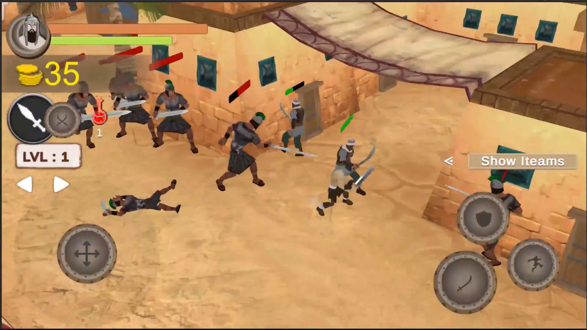
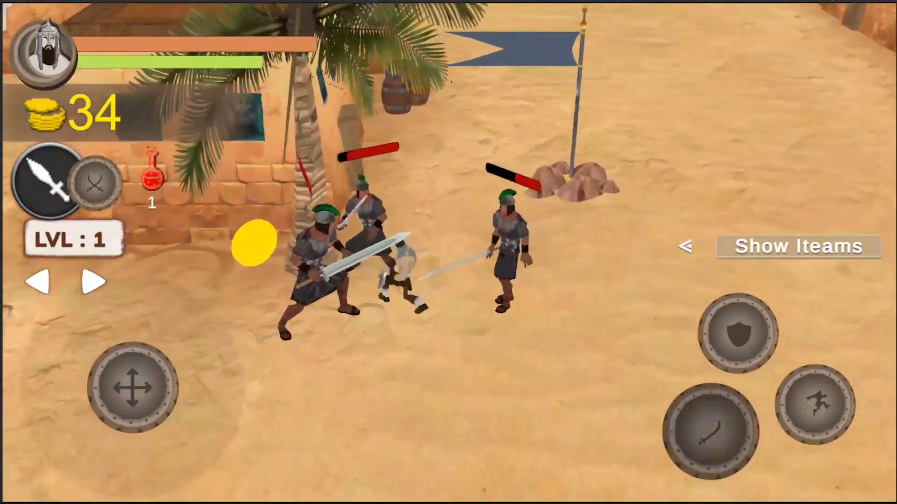
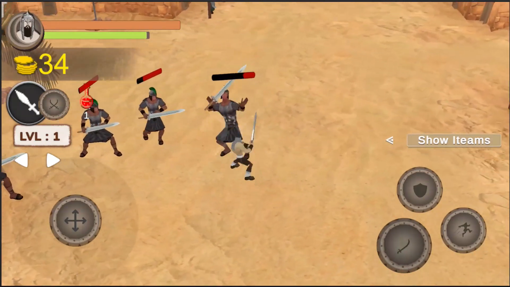
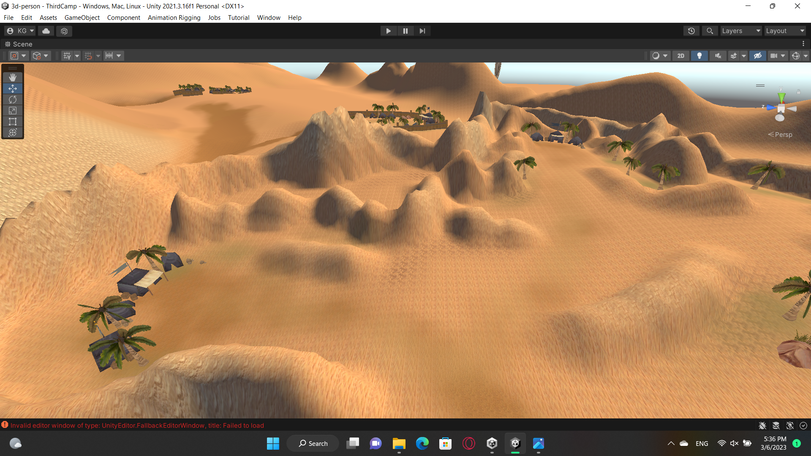
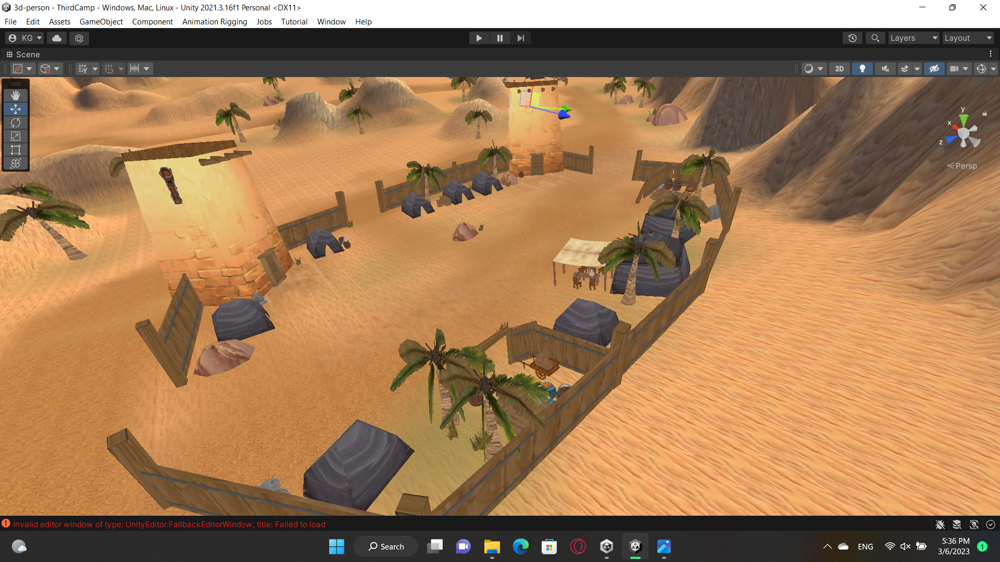
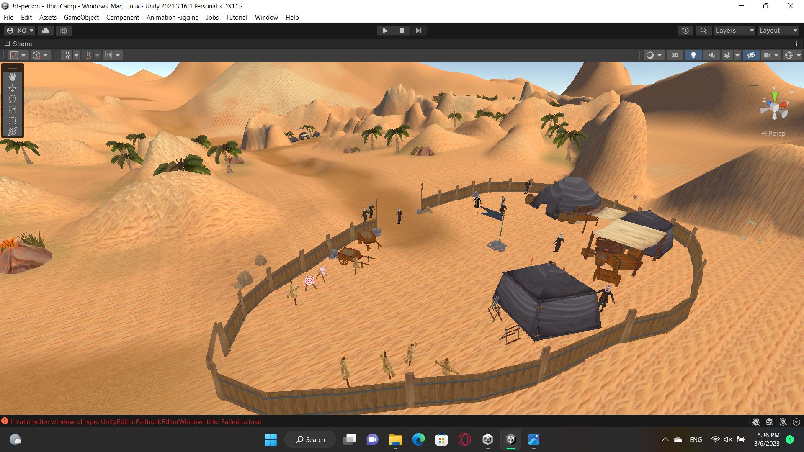

# Hero Project

### Honor, survival, and legacy in the Arabian Peninsula.

Hero Project is a third-person hack-and-slash game built with **Unity**, set in the ancient lands of present-day Saudi Arabia. It blends fast-paced melee combat with cultural and historical themes, placing tribal warriors in a struggle for honor, survival, and legacy.

## About the game

The game brings players into a pre-modern Arabian setting, with desert landscapes, fortified camps, and village streets forming the backdrop for close-range battles. Dynamic combat and cinematic presentation are central to the experience, giving the project a distinctive setting for third-person action.

## Highlights

- **Third-person melee combat:** Fast-paced hack-and-slash encounters against groups of enemies.
- **Arabian setting:** Environments inspired by the pre-modern Arabian Peninsula and the lands of present-day Saudi Arabia.
- **Cultural and historical themes:** A world centered on tribal warriors, honor, survival, and legacy.
- **Varied environments:** Sandy hills, palm-lined settlements, and desert encampments.
- **Unity development:** 3D environments, animated characters, and combat brought together in Unity.

## Project focus

Hero Project explores how dynamic melee combat and an Arabian-inspired world can work together in an action game. Its visual direction uses warm desert colors, regional architectural motifs, and warrior characters to establish the setting.

## Screenshots

### Combat

**Village combat**

**Enemy encounter**

**Melee action**

### Environments

**Desert landscape**

**Fortified camp**

**Desert encampment**

## Repository purpose

This repository is a public portfolio showcase of Hero Project. It contains a project overview and screenshots; the game's source code and executable builds are not included.

---

A project by [Kabbashi Gasim](https://github.com/kabashi1999).
